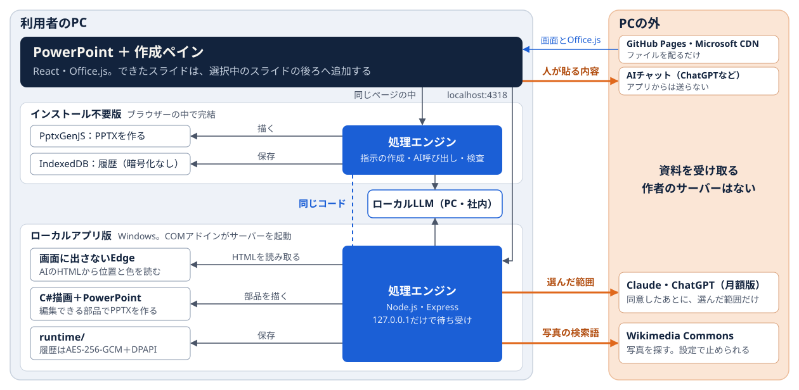
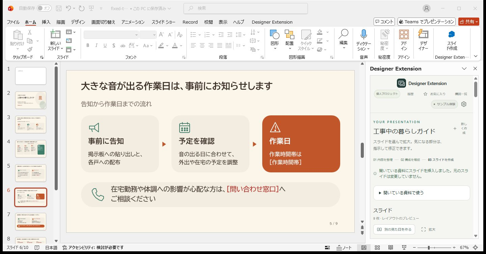

# Designer Extension

依頼文と資料から、PowerPointでそのまま直せるスライドを作るアドインです。機密をどこまで外部のAIへ送るかを作成前に選べ、数値・出典・崩れはアプリが確かめます。

個人制作です。作者が発注者兼PMとして要件・構成・受け入れを決め、実装の多くはClaude Codeが行いました。





## 読むもの

| 知りたいこと | 読むもの |
|---|---|
| 全体を短く見たい | [紹介サイト](https://runba7776.github.io/DesignerExtention/portfolio/)（[PDF](portfolio/Designer-Extension-portfolio.pdf)） |
| 動くところを見たい | [サンプルを再生](https://runba7776.github.io/DesignerExtention/?sample=1)（入力もログインも不要。AIを呼ばず、実際に作った記録を再生します） |
| できた資料を見たい | [サンプルのPPTX](portfolio/Designer-Extension-sample.pptx) |
| 要件・構成・非機能・導入審査・運用計画 | [設計書](docs/system-design.md) |
| PowerPointに入れたい | [インストール不要版](docs/no-install.md)、Windowsで全機能を使うなら `Setup-DesignerExtension.cmd` |
| 機能と操作の詳細 | [製品ガイド](docs/product-guide.md) |

## 確かめたこと

| 確かめたこと | 結果 |
|---|---|
| 5枚の資料が最後までできる | Claude 10/10本、ローカルLLM 5/5本 |
| 1本を作る時間 | Claude 114〜255秒、ローカルLLM 105〜358秒（回数が少ないので目安） |
| 外部のAIに送る骨組みへの文字の混入 | 0件（アプリとは別の照合） |
| 実機のPowerPointへの挿入 | 3案とも成功、10枚の案は約3秒 |
| 自動テスト | 312件合格 |
| 依存パッケージの既知の脆弱性 | 0件（`npm audit`、2026-11-07） |

## 確かめていないこと

- PowerPoint for the webへの実際の読み込み、Windowsの共有フォルダーでの読み込み、Mac
- ChatGPT月額版の実際のアカウントでの動作（自動テストまで）
- 組織での配布（[導入・運用計画](docs/system-design.md#6-導入運用計画想定)は想定で、実施していません）
- 作者以外の人による試用、外部の脆弱性診断、負荷試験

事実の誤りは検査できません。ローカルアプリ版は未署名なので、このまま全社には配りません。

## 開発

Windows、デスクトップ版PowerPoint、Node.js 22以降、.NET Framework 4.xを前提とします。

```powershell
npm run typecheck
npm test
npm run build:hosted   # インストール不要版（dist/hosted）
npm run serve:hosted   # https://localhost:4320/ で公開時と同じ状態を確認
```

mainへのpushごとにGitHub Actionsが型検査・書式検査・テストを行い、すべて通ったときだけインストール不要版と紹介サイトを公開します。

ライセンスはまだ決めていません。
