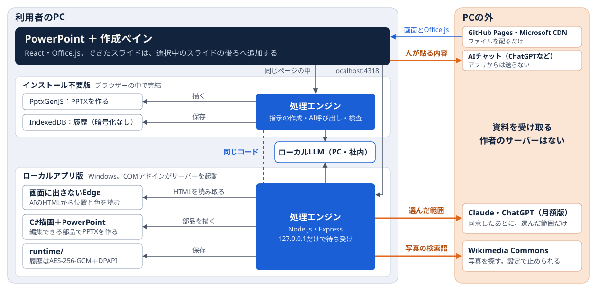
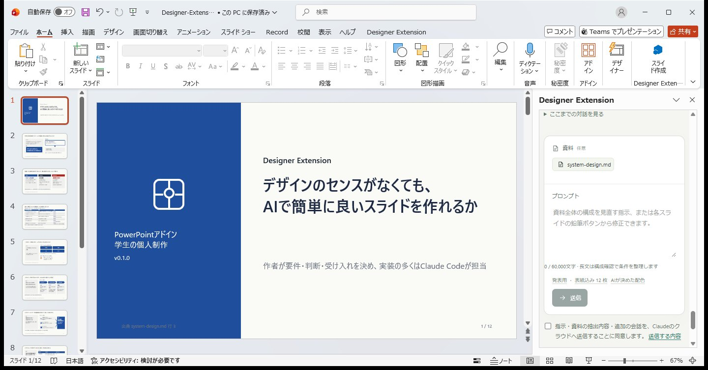

# Designer Extension

依頼文と資料から、PowerPointでそのまま直せるスライドを作るアドインです。機密をどこまで外部のAIへ送るかを作成前に選べ、数値・出典・崩れはアプリが確かめます。

個人制作です。作者が発注者兼PMとして要件・構成・受け入れを決め、実装の多くはClaude Codeが行いました。





## 読むもの

| 知りたいこと | 読むもの |
|---|---|
| 全体を短く見たい | [紹介サイト](https://runba7776.github.io/DesignerExtention/portfolio/)（[PDF](portfolio/Designer-Extension-portfolio.pdf)） |
| 動くところを見たい | [サンプルを再生](https://runba7776.github.io/DesignerExtention/?sample=1)（入力もログインも不要。AIを呼ばず、実際に作った記録を再生します） |
| できた資料を見たい | [サンプルのPPTX](portfolio/Designer-Extension-sample.pptx) |
| 背景・こだわり・要件・構成・非機能・判断 | [設計書](docs/system-design.md) |
| PowerPointに入れたい | [インストール不要版](docs/no-install.md)、Windowsで全機能を使うなら `Setup-DesignerExtension.cmd` |
| 機能と操作の詳細 | [製品ガイド](docs/product-guide.md) |

## 試してもらうとき

作者がサーバーを立てる必要はありません。公開ページはGitHub Pagesに置いたファイルだけで、処理は開いた人のブラウザーの中で動きます。入力や資料が作者に届くこともありません。

| 手軽な順 | 相手がすること | 要るもの |
|---|---|---|
| 1. サンプルを再生する（いちばん手軽） | [このリンク](https://runba7776.github.io/DesignerExtention/?sample=1)を開き、B案の「この案で進める」→「この構成で作成」を押す。12枚ができ、PPTXも保存できる | ブラウザーだけ。入力・ログイン・インストール・AIは要らない |
| 2. 自分の資料で作る | [公開ページ](https://runba7776.github.io/DesignerExtention/)で「AIチャットに貼り付ける」を選び、指示をふだん使うAIチャットに貼って、返答を取り込む | ブラウザーとAIチャット。APIキーは要らない |
| 3. PowerPointの中で使う | 公開ページから `manifest.xml` を保存して、PowerPointに読み込む（[手順](docs/no-install.md)） | PowerPoint。Web版への読み込みは未確認 |
| 4. 全機能を使う（月額版のClaude・ChatGPTでの自動作成など） | このリポジトリを取得して `Setup-DesignerExtension.cmd` を実行する | Windows、デスクトップ版PowerPoint、Node.js 22以降 |

まず1のリンクを送るのが確実です。ページを開けない環境には、[紹介のPDF](portfolio/Designer-Extension-portfolio.pdf)と[サンプルのPPTX](portfolio/Designer-Extension-sample.pptx)をファイルで渡せます。

## 確かめたこと

| 確かめたこと | 結果 |
|---|---|
| 5枚の資料が最後までできる | Claude 10/10本、ローカルLLM 5/5本 |
| 1本を作る時間 | Claude 114〜255秒、ローカルLLM 105〜358秒（回数が少ないので目安） |
| 外部のAIに送る骨組みへの文字の混入 | 0件（アプリとは別の照合） |
| 実機のPowerPointへの挿入 | 3案とも成功、10枚の案は約3秒 |
| 自動テスト | 323件合格 |
| 依存パッケージの既知の脆弱性 | 0件（`npm audit`、2026-11-07） |

## 確かめていないこと

- PowerPoint for the webへの実際の読み込み、Windowsの共有フォルダーでの読み込み、Mac
- ChatGPT月額版の実際のアカウントでの動作（自動テストまで）
- 組織での配布
- 作者以外の人による試用、外部の脆弱性診断、負荷試験

事実の誤りは検査できません。

## 開発

Windows、デスクトップ版PowerPoint、Node.js 22以降、.NET Framework 4.xを前提とします。

```powershell
npm run typecheck
npm test               # 1ファイルずつ順に流します（約2分）
npm run build:hosted   # インストール不要版（dist/hosted）
npm run serve:hosted   # https://localhost:4320/ で公開時と同じ状態を確認
```

変更はPRで入れ、GitHub Actionsが型検査・書式検査・テストとCodeQLの静的解析を行います。mainに入り、型検査・書式検査・テストが通ったときだけ、インストール不要版と紹介サイトを公開します（CodeQLは別に走り、公開の条件には入れていません）。依存パッケージとActionsの更新は、Dependabotが週1回提案します。

ライセンスは [MIT](LICENSE) です。脆弱性の報告は [SECURITY.md](SECURITY.md) を見てください。
