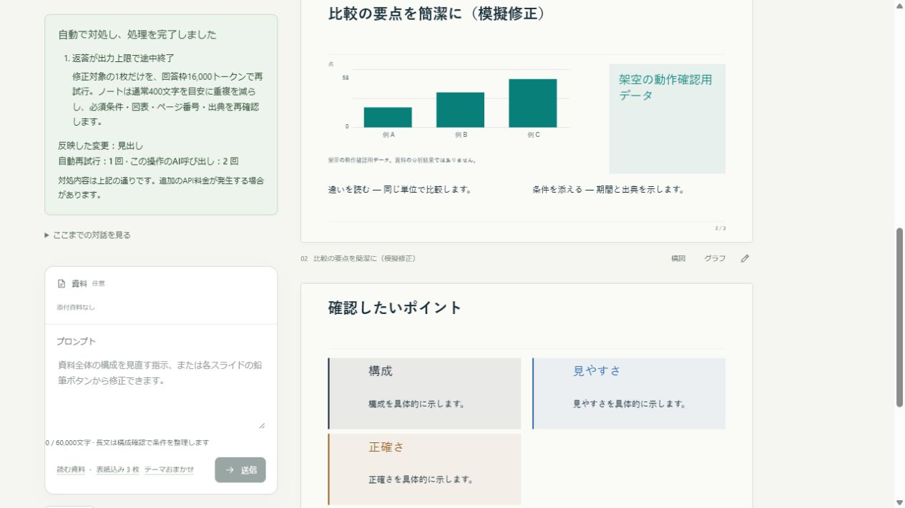
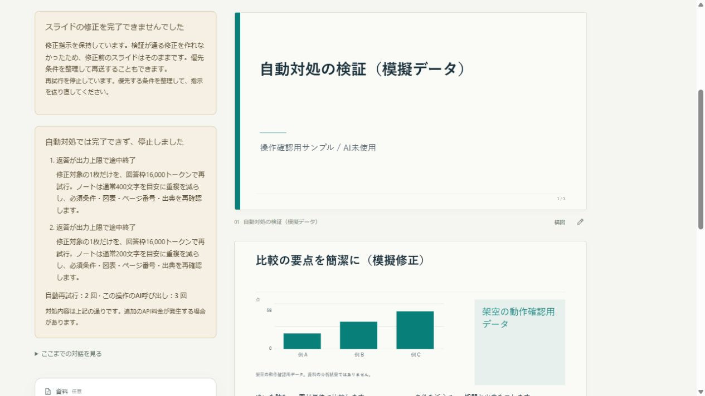

# v0.8.3：生成・修正の不備を自動で対処する

このページは旧版の検証記録です。v0.10.0の月額版・ローカル連携は[現在の操作説明](subscription-mode.md)を参照してください。

設定の「生成・修正の不備を自動で対処」がオンの場合、1回の操作につき最大2回、自動で対処して再試行します。初期設定はオンです。変更は現在の資料にも次の操作から適用されます。合計12回という1作業のAI呼び出し上限は維持します。

|問題|対処|
|---|---|
|構成の出力上限|見出し・役割・要点に絞り、回答枠を16,000から20,000トークンへ拡張。指定の枚数と条件を保持します。|
|本文の出力上限|最後まで返されたページの識別子・順序・文法・出典を検証して再利用し、残りを少ない枚数に分けます。回答枠は最大16,000です。|
|1枚の修正の出力上限|通常8,000、再試行時16,000トークンの回答枠。修正対象の1枚だけを作り、ノートの重複を減らします。通常400文字、2度目は200文字を目安にしますが、必須条件は省きません。|
|JSONやページ・図形・図表の仕様の不備|正しい形式、指定のID・順序・枚数・モード・図形文法・図表データを再確認して作り直します。|
|資料にない出典・一致しない引用|資料に実在する位置と短い原文だけを使うよう対処し、アプリで再検証します。間違った出典を黙って削って完成扱いにはしません。|
|文字量や要約の不備|完成した本文と調整済み文章を再利用し、未調整部分だけを短くします。要約へ資料は再送せず、図表の値・数式・出典を書き換えません。|

返答の修正指示にはアプリで用意した対処だけを使います。不正な返答やエラーに含まれる文章を、そのまま次の指示へ転記しません。未完成のJSONに括弧を足して完成したふりをせず、個別ページにも通常の検証を行います。

画面の「自動対処の結果」には、原因、回答枠・小分け・確認方法などの対処内容、自動再試行の回数とその操作全体のAI呼び出し数を表示します。1枚の修正を反映できた場合は、見出し・本文・発表者ノート・グラフ・出典など、実際に変わった項目も表示します。成功した対処の説明は会話と一緒に履歴へ残します。

自動対処でも完了できない場合は停止します。修正は検証が通るまで元のスライドと書き出し済みファイルを保持し、指示欄の文章も消しません。条件を整理して再送するか、利用できる場合は「保存した修正指示で再試行」を使います。同じ修正で3回不備が出た場合は、そのままの再送・再開を止めます。文字量調整だけが失敗したときは、保持した修正本文を再生成せずに調整を再開します。

自動対処をオフにすると、出力上限では保持した内容から手動で再開できます。形式・出典の不備はエラーとして表示する場合があります。自動再試行は行いません。通信・認証・モデルの入力枠の問題、送信同意や送信先の変更は、自動で設定を書き換えず、案内して停止します。ローカルからClaudeへ切り替えません。

自動再試行には追加のAPI料金が発生する場合があります。設定オフと回数上限で費用を制御できます。分割で入力の再送が増えることがあるため、常に料金が下がるという保証ではありません。

途中の作業・未反映の修正指示は同じサーバー起動中の保持です。更新時は修正指示をコピーし、履歴やPowerPointへ保存してから `Restart-DesignerExtension.cmd` を実行し、APIキーを再入力してください。保存済みの資料は履歴から開いて修正でき、開く操作にAI呼び出しはありません。

76項目の自動テストが成功。模擬応答の画面でも、生成中断からの自動再開、1枚の修正の自動対処と反映項目の表示、3回失敗した場合の停止・指示保持を確認しています。テストは有料API呼び出し0回です。実際のClaude・ローカルLLMによるすべての応答や生成品質を保証する検証ではありません。

