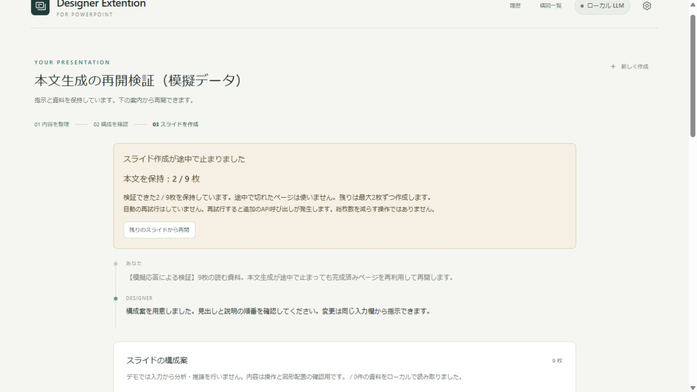
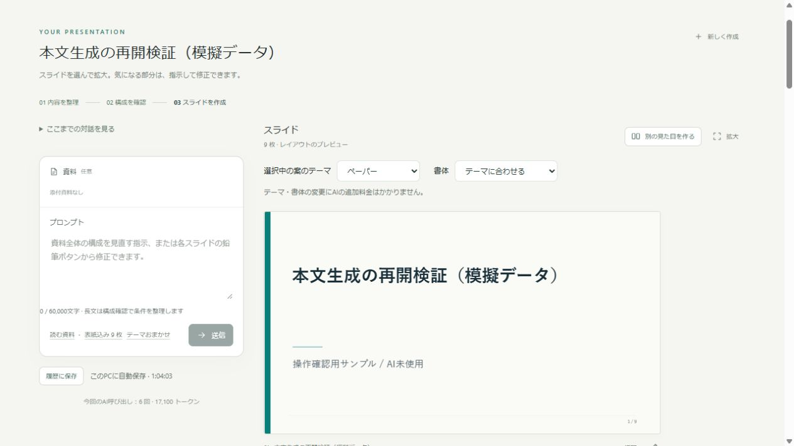
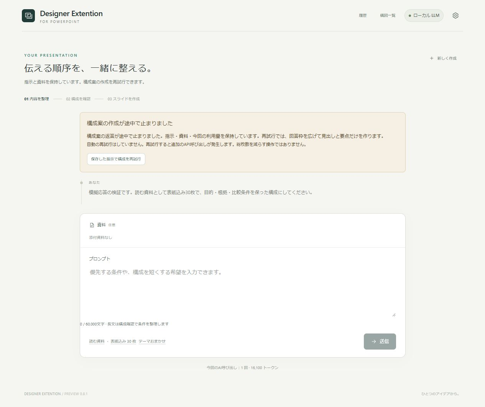
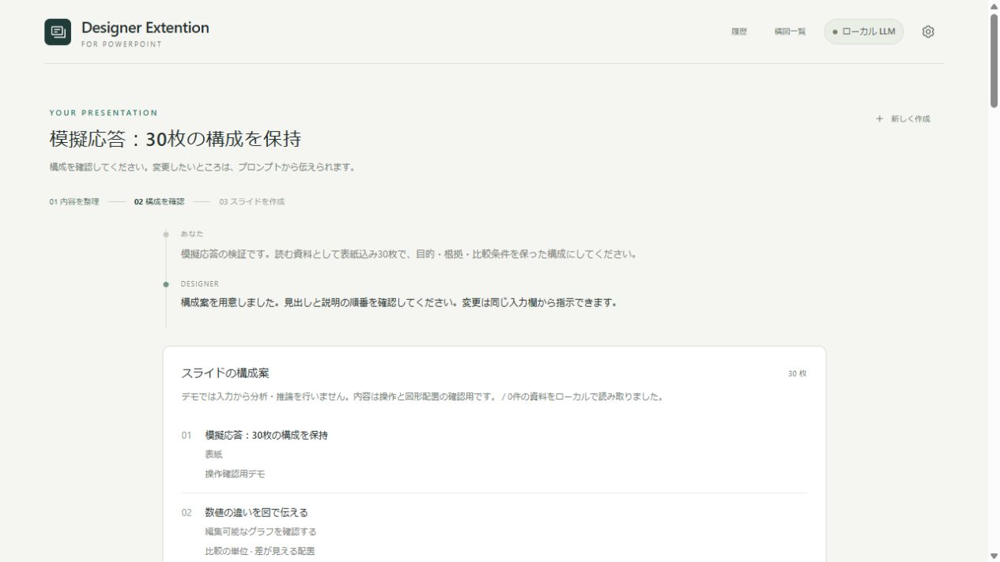

# v0.8.3：生成・修正の不備に自動対処する

このページは旧版の検証記録です。v0.10.0の月額版・ローカル連携は[現在の操作説明](subscription-mode.md)を参照してください。

最新版では「修正する」の後に出る出力上限も対象にし、構成相談・本文生成・1枚の修正・文字量調整を、1回の操作につき最大2回まで自動で対処します。設定の「生成・修正の不備を自動で対処」でオン・オフを変更できます。オンが初期設定です。出力枠の調整、小分け、重複の除去、形式・出典の再確認を行い、対処後は理由と調整内容、修正で実際に変わった箇所、呼び出し回数を表示します。

修正の回答枠は通常8,000、自動対処時は16,000トークンまでです。修正指示と修正前の資料を保持し、検証が通るまで結果を置き換えません。本文完成後に文字量調整で失敗した場合は本文を再生成しません。合計12呼び出しの制限は維持します。

自動対処後も完了できなければ、対処内容を表示して停止します。以下のv0.8.2以前の「ボタンでのみ再試行」の説明は、自動対処オフ時の手動操作を参考にしてください。詳細と検証画面は[自動対処の使い方](automatic-repair.md)を参照してください。

## v0.8.2：スライド本文の生成から再開する（旧版の説明）

「この構成で作成」を押した後の出力上限にも対応しました。構成案の出力上限とは別に、本文生成は従来最大8枚を一度に返すため、説明やノートが多い資料では途中で止まることがありました。

- 最初の本文生成は発表用6枚、読む資料用4枚まで。回答枠は最大16,000トークンとし、未使用項目・長い重複ノート・不要な原文の転載を減らす指示を追加しています。数字・単位・比較条件・必須条件を勝手に減らす操作ではありません。
- 出力上限で止まったときは、自動で呼び直しません。返答の中で最後まで閉じたJSONのページだけを検証します。ページ番号・順序・表紙の役割・文字や図表の仕様・出典位置・引用が確認できた連続部分を保持します。途中で切れたページを継ぎ足したり、未完成資料を書き出したりしません。
- 画面の「本文を保持：2 / 9 枚」などを確認し、「残りのスライドから再開」を押すと、未作成のページだけを、前回の半分の枚数（最少1枚）に分けて作成します。総枚数は維持します。回答枠は16,000トークンまで使えますが、その上限まで毎回書くようには指示しません。
- 本文が全て揃い、文字量の調整だけで止まった場合は「保持した本文を仕上げる」を押します。調整済みのページは保持し、残りの文章だけを小分けに要約します。資料は要約の呼び出しへ再送しません。本文・グラフの値・出典を再生成しません。
- 同じ未完成の1枚で2回上限に達した場合や、1作業の合計12回の呼び出しを使った場合は再開を止めます。プロンプトで優先条件を整理するか、構成案で情報を分けてください。停止した返答の利用量も計上します。

保持する途中の本文は、同じ画面・同じサーバー起動中だけの作業データです。再起動、「新しく作成」、構成の変更後は途中の本文をそのまま再利用できません。完成した資料は従来通り履歴へ保存します。更新前に指示をコピーし、作成済み資料を保存してから `Restart-DesignerExtension.cmd` を実行し、APIキーを再入力してください。現在の旧版で失敗した返答は、この更新で後から回収できません。

小分けにすると入力の再送回数は増える場合があります。常に料金が下がるという保証ではなく、出力失敗による全文再生成を避けるための仕組みです。再開を押したときだけ追加のAPI料金が発生し得ます。

62項目の自動テストで、完了ページの再利用、未完成JSON・誤った出典・異なるページ番号の除外、利用量、回数上限、文字量の調整からの再開、既存の構成相談と履歴などを検証しました。画面でも模擬応答の2 / 9枚から残りを生成し、9枚を完成しています。実際のClaudeやローカルLLMによる生成品質は、この検証では確認していません。有料API呼び出しは0回です。

## v0.8.1：構成案の出力上限への対処

「最初の構成を考える」の後に出る出力上限エラーは、入力欄の60,000文字とは別の制限です。従来の構成相談は、AIの返答を8,000トークンまでに固定していました。長い指示や多い枚数について、各ページを詳しく書こうとすると途中で止まる場合がありました。

更新版では構成相談の回答枠を16,000トークンに拡張し、本文・図表データ・発表者ノートは構成承認後に作るよう指示を分けました。構成段階は見出し・役割・短い要点だけを返します。指定した総枚数と必須条件を減らす指示ではありません。

それでも上限に達した場合は、指示・資料・会話・利用量を同じ作業内に保持し、「保存した指示で構成を再試行」を表示します。自動の再試行は行いません。ボタンを押した場合だけ、回答枠を20,000トークンに広げて、構成の要点をさらに簡潔に返すよう依頼します。途中のJSONを継ぎ足して完成したふりをせず、構成案を改めて作る操作です。同じ指示での上限が2回続いた場合は、そのボタンを止めて、プロンプト欄で優先する条件を整理するよう案内します。

失敗した応答もAPI費用の対象になる場合があるため、失敗時の呼び出し数と返されたトークン数も表示します。返答の上限を広げても、毎回その上限まで生成するようには指示しません。本文を構成案に詰め込まず、出力を短くすることも合わせて行います。

入力と会話を保持するのはこの起動中です。構成がまだ完成していない作業は、履歴に自動保存した完成資料とは異なり、再起動では復元されません。更新時は入力中の指示をコピーしてから `Restart-DesignerExtension.cmd` を実行し、APIキーを再入力してください。

54項目の自動テストで、Claude/ローカルの上限応答、入力と資料の保持、利用量の計上、ユーザー操作時だけの再試行、繰り返しの抑止、30枚を保った構成の再開を確認しました。実際のClaudeを呼び出さず、模擬応答で検証しています。モデルによる構成品質や、全ての長文で上限に達しないことを確認した検証ではありません。

APIの停止理由は[Anthropicの公式資料](https://platform.claude.com/docs/en/build-with-claude/handling-stop-reasons)を参考にしています。モデルの入力枠を使い切った場合は、出力上限と区別して資料の対象範囲を分けるよう案内します。

