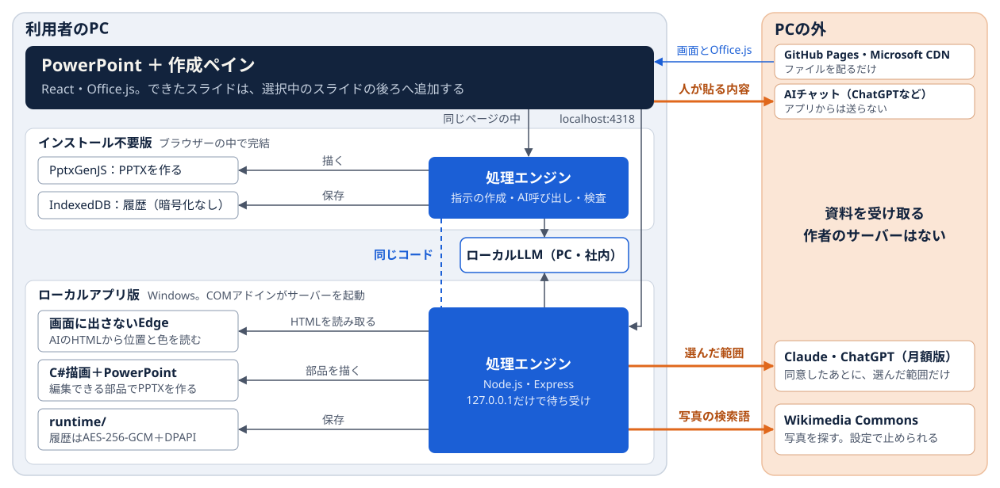

# Designer Extension 設計書

v0.1.0時点の要件・全体構成・非機能要件・導入審査・運用計画・判断の記録です。個人制作で、作者が発注者兼PMとして要件と受け入れを決め、実装の多くはClaude Codeが行いました。

状態の書き方は次のとおりです。

- **確認済**：実機のPowerPoint、または実際のAIで確かめた
- **試験のみ**：自動テストや保存データでの確認まで
- **想定**：計画だけで、実施していない
- **未試験**：対策は入れたが、効き目を試していない

目次：[1 要件](#1-要件) ／ [2 全体構成](#2-全体構成) ／ [3 データの流れ](#3-データの流れ) ／ [4 非機能要件](#4-非機能要件) ／ [5 導入審査シート](#5-導入審査シート) ／ [6 導入・運用計画](#6-導入運用計画想定) ／ [7 判断の記録](#7-判断の記録) ／ [8 検証の結果と未確認](#8-検証の結果と未確認)

## 1 要件

| 業務で困ること | 要件 | 実現の方法 | 状態 |
|---|---|---|---|
| 社外秘の資料を外部のAIへ送れない | 送る範囲を作成前に選べる。外へ出さない経路もある | 送る範囲の選択、ローカルLLM、送信前の照合 | 確認済 |
| AIの資料は作った後に直せない | 画像にせず、PowerPointの部品で出す | 文字枠・図形・表・グラフ。ローカルアプリ版はタイトル枠・グループ・コネクタも | 確認済 |
| AIは事実を作ってしまう | 資料にない事実を本文に書かせない | 記入欄［項目名］、数値と出典の照合 | 確認済（事実の誤りそのものは検出できない） |
| 毎回同じ見た目になる | 方向の違う案から人が選ぶ | 3案と「ありがちさ」の見積もり | 確認済 |
| 使うほど費用が増える | APIキーと従量課金を使わない | 月額版へのログイン、貼り付け、ローカルLLM | 確認済（ChatGPT月額版は試験のみ） |
| 評価や試行でソフトを入れられない | 実行ファイルなしで試せる | インストール不要版 | 確認済（Web版PowerPointへの読み込みは未確認） |

対象外：共同編集、利用者管理やSSO、管理画面、内容の正しさの保証。

## 2 全体構成

| 要素 | 技術 | 役割 | インストール不要版 | ローカルアプリ版 |
|---|---|---|---|---|
| 作成画面 | React・TypeScript・Office.js | 入力、案の選択、プレビュー、挿入 | ○ | ○ |
| 処理エンジン | TypeScript（両版で共有） | 指示の作成、AI呼び出し、検査、履歴 | ブラウザーの中 | ローカルサーバーの中 |
| ローカルサーバー | Node.js・Express | 画面とエンジンの間。127.0.0.1だけで待ち受け | － | ○ |
| HTMLの読み取り | 画面に出さないEdge（DevTools Protocol） | AIのHTMLを描き、位置・色・改行・書体を読む | － | ○ |
| PowerPoint描画 | C#・.NET Framework（COM） | 部品でPPTXを作り、ページの画像を書き出す | － | ○ |
| ブラウザー描画 | PptxGenJS | ブラウザーの中でPPTXを作る | ○ | － |
| 起動 | COMアドイン＋Node.js | PowerPoint起動時にサーバーを起動（PowerShellは使わない） | － | ○ |
| 保存 | IndexedDB／`runtime/`（履歴はAES-256-GCM＋DPAPI） | 履歴、お気に入り、設定 | IndexedDB | `runtime/` |
| 配信 | GitHub Pages（静的ファイルのみ） | 検査に通った版だけを公開 | ○ | － |

規模：画面約1.4万行、サーバー約1.5万行、共有処理約1万行、C#約2千行、テスト約1.4万行。

## 3 データの流れ

### 作り方ごとの送り先

| 作り方 | 送り先 | 送るもの | 送らないもの |
|---|---|---|---|
| 月額版・そのまま送る | Claude（公式Claude Code経由）／ChatGPT（`api.openai.com`、`store:false`） | 指示、資料の抽出内容、会話 | － |
| 月額版・伏せ字 | 同上 | 文章。社名・指定語・連絡先・数値は【社名1】などの記号に置換 | 伏せた元の語と数値（返答はPC内で元に戻す） |
| 内容は送らない（骨組み） | 文章はローカルLLM、デザインだけ同上 | 文字枠の役割と文字数、グラフと表の形、色の名前（選べば話題名も） | 文章、数値、資料、会話 |
| ローカルLLM | 127.0.0.1、10.x、172.16〜31.x、192.168.xのサーバーだけ | 指示、資料の抽出内容 | クラウドへは送らない |
| AIチャットに貼り付け | 利用者が貼るチャット | 利用者が貼った内容 | アプリからの自動送信はない |
| サンプル体験 | なし | なし | 記録の再生でAIを呼ばない |

骨組みと伏せ字は、送る前に資料・本文と突き合わせます。骨組みでは同じ文字の並びや資料の数値が1つでもあれば作成を止め、伏せ字では伏せた語が残っていないことを確かめます。照合の結果と指示のSHA-256は、PC内の送信記録に残します。

### 通信先の一覧

| 通信先 | 用途 | いつ | 版 |
|---|---|---|---|
| `127.0.0.1:4317`、`localhost:4318` | 画面とローカルサーバー（PCの外へは出ない） | 常時 | ローカル |
| `officeapis.public.onecdn.static.microsoft` | Office.js | ペインの読み込み時 | 両方 |
| 公開ページ（GitHub Pages） | 画面ファイルの配信 | ページの読み込み時 | 不要版 |
| 公式Claude Codeの通信先（[Anthropicの案内](https://code.claude.com/docs/en/network-config)） | Claude | 接続時と作成時 | ローカル |
| `auth.openai.com`、`api.openai.com` | ChatGPTのログインと作成 | 接続時と作成時 | ローカル |
| 登録したローカルLLM（ループバックと社内のプライベートアドレスだけ） | 作成 | 作成時 | 両方 |
| 利用者が開くAIチャット | 利用者が貼った内容（アプリは通信しない） | 利用者の操作時 | 両方 |
| `commons.wikimedia.org`、`upload.wikimedia.org` | 写真の検索と取得（英語の検索語だけ） | そのまま送る設定の作成時。設定で止められる。ローカルLLM・伏せ字・骨組みでは使わない | ローカル |
| `registry.npmjs.org` | 依存パッケージの取得 | Setupの実行時のみ | ローカル |

## 4 非機能要件

分類はIPAの[非機能要求グレード](https://www.ipa.go.jp/archive/digital/iot-en-ci/jyouryuu/hikinou/ent03-b.html)の6大項目です。

| 分類 | 決めたこと | 実績・根拠 | 状態 |
|---|---|---|---|
| 可用性 | 返答が切れても完成したページは残し、通らなかったページだけ頼み直す | 固定5題で完成：Claude 10/10本、ローカルLLM 5/5本 | 確認済 |
| 可用性 | サーバーが止まっていても、PowerPointの起動で自動で立ち上がる | 起動から約4秒で復帰 | 確認済 |
| 性能・拡張性 | 5枚の資料を数分で作る | Claude 114〜255秒、ローカルLLM 105〜358秒（回数が少ないので目安） | 確認済 |
| 性能・拡張性 | 画面は待たせない | 公開ページ約0.5秒で操作可能、ペイン約2秒、10枚の挿入約3秒 | 確認済 |
| 性能・拡張性 | サーバーを共有せず、利用者のPCかブラウザーで動かす | 利用者数で処理が混まない。月額版は1人同時に1本 | 確認済 |
| 性能・拡張性 | 上限を決めて超える前に止める | 1ファイル15MB・8件・抽出12万文字・指示6万文字・AI呼び出し1操作12回／1資料40回 | 試験のみ |
| 運用・保守性 | 検査に通った版だけ公開する | mainへの変更ごとに型検査・書式検査・自動テスト | 確認済 |
| 運用・保守性 | 古い画面で作業を続けさせない | 更新が必要なときは画面に案内し、操作を止める | 試験のみ |
| 運用・保守性 | 依存パッケージの脆弱性を放置しない | `npm audit` 0件（2026-11-07） | 確認済 |
| 運用・保守性 | 調べる手がかりを残す | 起動ログ、送信記録。ログは起動ごとに上書き | 確認済 |
| 移行性 | 成果物は標準のPPTX。アプリをやめても資料は残る | PowerPointで編集できる部品で保存 | 確認済 |
| 移行性 | 既存の資料を壊さない | 選択中のスライドの後ろへ追加し、元は変更しない | 確認済 |
| 移行性 | 履歴はPCを越えて移さない | DPAPIで保護するので別のPCでは読めない。残す資料はPPTXへ | 確認済 |
| セキュリティ | 外部から接続できない | 127.0.0.1／localhostだけで待ち受け。Host・Origin・Fetch Metadata・HttpOnly Cookie・CSPを検証 | 試験のみ |
| セキュリティ | 保存データを守る | 履歴はAES-256-GCM、鍵とChatGPTのトークンはDPAPI。お気に入り・書き出したPPTX・プレビューは暗号化しない | 確認済 |
| セキュリティ | 認証情報を預からない | APIキー不使用。Claudeのログインは公式Claude Codeが管理し、渡す環境変数は許可リストのみ | 試験のみ |
| セキュリティ | AIの出力を実行しない | HTMLからスクリプトと外部URLを除き、スクリプト無効＋CSPで描画。Claude Codeはツールなし・MCPなし・会話保存なし | 確認済 |
| セキュリティ | 資料の中の指示に従わせない | 資料は参考データと伝える。完全な防御ではなく、攻撃の試験もしていない | 未試験 |
| システム環境・エコロジー | 管理者権限なしで動く | ローカル版：Windows、デスクトップ版PowerPoint、Node.js 22以降、.NET Framework 4.x、Edge。不要版：ブラウザーまたはPowerPoint | 確認済 |

未対応：コード署名、SSOと権限管理、ログの集中管理、外部の脆弱性診断、負荷試験、稼働率の目標（個人制作で運用組織がないため定めていない）。

## 5 導入審査シート

情シスの審査で聞かれる項目を、版ごとに整理しました。

| 審査項目 | インストール不要版 | ローカルアプリ版 |
|---|---|---|
| 判断の目安 | 評価と小規模な試行向け | 個人の検証向け。このまま全社には配らない |
| 入れるもの | なし（マニフェストを読み込むだけ） | Node.js（前提）、npmの依存パッケージ、COMアドイン、描画プログラム |
| 管理者権限 | 不要（Windowsのデスクトップ版で共有フォルダーを作る場合は必要なことがある） | 不要 |
| 変更する設定 | Officeのアドイン一覧 | 現在のユーザーのレジストリ（COMアドイン登録、`WEF\Developer`）、現在のユーザーの証明書ストア（localhostの自己署名証明書） |
| コード署名 | 該当なし（Webアドイン） | なし |
| PowerShell | 使わない | Setupと登録の解除だけ。実行ポリシーの指定はそのプロセス限り。PowerPoint起動時は使わない |
| 受信ポート | なし | 127.0.0.1:4317、localhost:4318 |
| 外部への送信 | 利用者がチャットへ貼った内容、指定した社内のLLM | 接続して同意したClaude・ChatGPT、写真の検索語 |
| 保存先 | ブラウザーのIndexedDB（暗号化なし） | `runtime/`（履歴は暗号化、お気に入りとPPTXは暗号化なし） |
| 預かる認証情報 | なし | ChatGPTのトークン（DPAPI）。Claudeは公式Claude Codeが管理 |
| ログ | なし | `runtime/server.log`、`server-error.log`、送信記録 |
| 確認が要る規約 | 貼り付け先のAIの規約と社内規程 | OpenAI・Anthropicの契約と規約、Wikimedia Commonsの画像の利用条件（出典はアプリが記載） |
| 止める | ペインを閉じる | `Stop-DesignerExtension.cmd` |
| 削除する | アドインの削除、ブラウザーのサイトデータの削除 | `Uninstall-PowerPoint-Addin.cmd`、`Setup-Office-TaskPane.ps1 -Remove`（証明書）、フォルダーの削除 |

組織での導入を止める要因：ローカルアプリ版はコードが未署名で、自己署名証明書を各ユーザーに信頼させます。Officeから子プロセスを起動できない設定（Microsoft Defenderの攻撃面の縮小ルールなど）では自動起動が止まり、`Start-DesignerExtension.cmd` での手動起動になります。Setupは実行ポリシーをそのプロセスに限って指定し、Windowsの設定は変えません。グループポリシーでスクリプトの実行を制限している組織では、制限を回避せず管理者に確認してください。

## 6 導入・運用計画（想定）

**この章はすべて想定で、実施していません。** 前提は、従業員300人、Microsoft 365を利用、Windows PC、Intuneで端末管理、情シス3人、機密資料の外部送信は原則禁止という架空の会社です。期間と人数も仮の値です。

### 配布方法の比較

| 方法 | 利用者の作業 | 管理者の作業 | 更新 | 使いどころ |
|---|---|---|---|---|
| A 各自がマニフェストを読み込む | 毎回の案内が要る | なし | ページを更新すれば全員に届く | 情シスの評価。テナント設定で禁止されることがある |
| B 共有フォルダーのカタログ | 信頼設定が要る | フォルダーの共有と管理 | Aと同じ | 使わない（人手が多い） |
| C Microsoft 365の統合アプリで配布＋組織のHTTPSホスト | なし | 登録と対象の割り当て | ホストの更新で届く | **本命** |
| D ローカルアプリを署名してIntuneで配布 | なし | 署名、パッケージ、更新の配布 | Intuneで配る | PowerPoint本体での描画が要る部門だけ |

自己署名証明書の信頼や未署名スクリプトの実行は、全社員に求めません。Cの中身は次のとおりです。

1. Web画面を組織が管理するHTTPSホストへ置き、マニフェストのURLを変える。
2. Microsoft 365管理センターの統合アプリから、対象のユーザーやグループへ割り当てる。
3. AIの接続先、外部へ送れる資料の範囲、ログの保持期間を会社が決める。外部送信を禁止する間は、社内のローカルLLMか骨組みだけに絞る。

中央配布するOfficeアドインは、開発用の `localhost` のURLを使いません。このリポジトリには、署名済みインストーラー、組織のホスト、組織の証明書、テナントの配布設定は含まれていません。

参考：[Office Add-insの公開](https://learn.microsoft.com/en-us/office/dev/add-ins/publish/publish) ／ [統合アプリによる集中展開](https://learn.microsoft.com/en-us/microsoft-365/admin/manage/centralized-deployment-of-add-ins) ／ [PowerShellの実行ポリシー](https://learn.microsoft.com/en-us/powershell/module/microsoft.powershell.core/about/about_execution_policies)

### 段階導入

| 段階 | 目安 | 対象 | 経路 | 次へ進む条件 |
|---|---|---|---|---|
| 0 審査 | 2週間 | 情シス3人 | A＋サンプル体験 | 審査シートの完了、法務の確認 |
| 1 試行 | 1か月 | 1部門20人 | C＋社内のローカルLLM | 情報事故0件、作成と修正の時間が従来より短い |
| 2 拡大 | 2か月 | 希望部門100人 | C | 問い合わせが1人あたり月1件以下 |
| 3 全社 | － | 300人 | C | 正式な運用へ |

### 運用

| 場面 | 確認すること | 対応 |
|---|---|---|
| ペインが開かない（配布版） | テナントのアドイン許可、割り当て、ホストの稼働 | 管理者が確認 |
| 「接続が拒否されました」（ローカル版） | `runtime/server-error.log` | `Restart-DesignerExtension.cmd` |
| 版の更新を求められる | 画面の案内 | 開き直す。消えなければPowerPointを閉じてSetup |
| AIが返さない | 接続状態、利用枠、ローカルLLMの稼働 | 別の作り方に切り替える。自動で別のAIには送らない |
| PPTXを作れない | 画面のエラー、PowerPointのダイアログ | 閉じてやり直す。AIの呼び直しは起きない |

更新は月に1回を基本にし、依存パッケージの確認、自動テスト、試行部門、全社の順に広げます。廃止は、割り当ての解除、ホストの停止、端末のサイトデータと`runtime/`の削除の順です。作った資料はPPTXなので残ります。

## 7 判断の記録

| 問題 | 決めたこと | 根拠 |
|---|---|---|
| AIにスライドをどう書かせるか | 座標ではなくHTML/CSSで書かせ、部品に読み替える | 同じ10枚で232.8秒・6回→157.8秒・4回（2026-10-17） |
| 毎回同じ答えになる | 履歴を疑って調べ、原因はAI自身の偏りと判断。方向の違う3案から人が選ぶ形に | AIへの入力はバイト単位で同じ。7回作って7回とも同じ3題材（2026-10-18） |
| 事実を作ってしまう | 資料にない事実は記入欄に残し、入力はAIなしで全ページへ反映 | 1本に残る記入欄9〜17項目、作り手向けのメモ0件（2026-10-23） |
| 手直しで悪くなることがある | 描き直して前後を比べ、良くなったページだけ残す | 35ページ中22ページ採用、13ページは元に戻す（2026-11-03） |
| ローカルLLMの見比べが効かない | ローカルLLMでは手直しをやめ、指摘の一覧だけ出す | 見比べ17件がすべて「良くなった」。244秒・13.4回→195秒・9.4回（2026-11-05） |
| 機密を守りながらデザインもしたい | 文章はローカルLLM、外部のAIには骨組みだけ | 固定5題で完成。1本約96秒、送信約2,000〜2,800文字、混入0件（2026-11-01） |
| 費用と鍵の管理 | 従量課金のAPIを使わず、APIキーも持たない | 使うほど費用が増える仕組みと鍵の預かりをなくすため |
| EDRやASRに止められる起動 | PowerPoint起動時のPowerShellをやめ、Node.jsを直接起動 | 隠しウィンドウのPowerShellは監視製品に止められる恐れがある（2026-10-28） |
| 公開ページで自動作成を見せたい | 月額版を公開ページに載せず、実際の記録を再生する | 各社の条件を調べると、第三者アプリへのログイン組み込みや作者の枠の共有はできない（2026-11-07） |
| 全社にどう配るか | ローカル版を配らず、統合アプリと組織のホストへ移す案にした | 自己署名証明書と未署名スクリプトを全社員に求められないため |

## 8 検証の結果と未確認

| 確かめたこと | 結果 | 方法 |
|---|---|---|
| 5枚の資料が最後までできる | Claude 10/10本、ローカルLLM 5/5本 | 固定5題を実際のAIで作成（2026-11-03〜05） |
| PowerPointの部品になる | 25ページで、タイトル枠25、ページ番号25、図形内の文字32、定型図形21、グループ18、画像として貼ったSVG 0 | 保存したPPTXを解析 |
| 骨組みに文字が混ざらない | 混入0件 | 送った内容をアプリとは別に照合（2026-11-01） |
| 崩れの検査が誤って反応しない | 誤検出0件 | 保存したClaudeの50ページ |
| PowerPointへ挿入できる | 3案とも成功（1→11→20→28枚）、10枚の案は約3秒 | 実機のデスクトップ版（2026-11-07） |
| 自動テスト | 312件合格 | `npm test`（AIの返答は模擬し、利用枠を使わない） |

未確認：

- PowerPoint for the webへの実際の読み込み、Windowsの共有フォルダーでの読み込み、Mac
- ChatGPT月額版の実際のアカウントでの動作（送る内容は自動テストで確認）
- グラフと文字の重なりの検査、写真の切り抜き位置をずらす処理の実AIでの動作（保存データと自動テストまで）
- 6章の組織での配布すべて
- 作者以外の人による試用
- 事実の誤りは検査できません。依頼にない言い回しや、人名の誤記は検査を通ります

検証の数値は、回数が少なく、AIの結果は毎回ばらつくので目安です。題材と数値は検証用の架空のものです。
