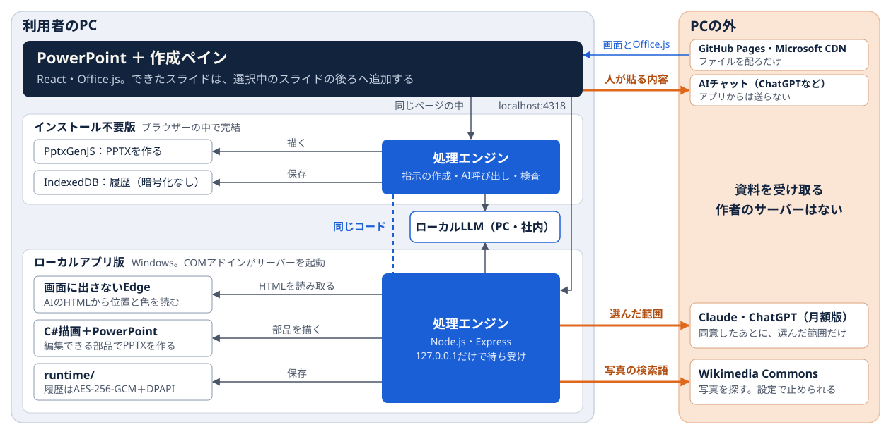

# Designer Extension 設計書

v0.1.0時点の背景・こだわり・要件・全体構成・非機能要件・判断の記録です。個人制作で、作者が発注者兼PMとして要件と受け入れを決め、実装の多くはClaude Codeが行いました。

状態の書き方は次のとおりです。

- **確認済**：実機のPowerPoint、または実際のAIで確かめた
- **試験のみ**：自動テストや保存データでの確認まで
- **想定**：計画だけで、実施していない
- **未試験**：対策は入れたが、効き目を試していない

目次：[0 背景](#0-背景) ／ [1 要件](#1-要件) ／ [2 全体構成](#2-全体構成) ／ [3 データの流れ](#3-データの流れ) ／ [4 非機能要件](#4-非機能要件) ／ [5 判断の記録](#5-判断の記録) ／ [6 検証の結果と未確認](#6-検証の結果と未確認)

## 0 背景

| 項目 | 内容 |
|---|---|
| きっかけ | 大学の発表でPowerPointのスライドを作るとき、AIがどこまで人が作ったようなスライドを作れるのか、技術的に気になった |
| 問い | AIはどこまで、人が作ったようなスライドを作れるか |
| 進め方 | AIによるスライド作成の弱点を調べて要件にした。作者が要件・判断・受け入れを決め、実装の多くはClaude Codeに任せた |
| 1章の課題 | 調べて想定したもの。作者が業務で困った経験ではない |

こだわったこと（理由は作者の言葉）：

| こだわり | なぜ | どうした | 結果 |
|---|---|---|---|
| 画像にせず、PowerPointで直せる部品で出す | 人が手直ししやすくするため | 文字枠・図形・表・グラフで出す。ローカルアプリ版はタイトル枠・グループ・コネクタも | 25ページで、画像として貼った図は0（6章） |
| 見た目はAIに任せる | 使う人によって出来が大きく左右されないため | 配色・書体・構図はAIが決め、アプリは事実の決まりと文字の大きさの下限などの制約だけを伝える。ページはHTML/CSSで書かせ、部品に読み替える | AIに任せると似た見た目に寄ったので、方向の違う3案から選ぶ形にした（5章） |
| 費用をかけず、個人で完結させる | 費用の面。個人で完結させたいため | APIキーと従量課金を使わない。月額版へのログイン、チャットへの貼り付け、ローカルLLMで作る。サーバーを持たず、自分のPCかブラウザーで動かす | 使った量で費用が増えない。鍵も預からない |
| 中身を外へ出さない道を選べる | 最近の機密情報の漏洩が続いているのを見て、特に | 送る範囲を作成前に選ぶ。文章はローカルLLM、外部のAIには骨組みだけを送り、送る前に資料と照合する（3章） | 骨組みへの文字の混入0件（6章） |
| 試すのにファイルを実行させない | ファイルの実行はハードルが高く感じるため。なるべくサイトで済ませたい | インストール不要版（ブラウザーで動く）と、AIも入力も使わないサンプル再生 | 公開ページだけで試せる（Web版PowerPointへの読み込みは未確認） |

同じ方向の製品として、OpenAIの公式アドイン「ChatGPT for PowerPoint」が2026年5月にベータで公開され、その後一般提供されました（[報道](https://www.thurrott.com/a-i/336411/openai-launches-chatgpt-for-powerpoint-add-in-in-beta)）。PowerPointの中でAIが編集できるスライドを作る点は同じです。このアドインは次の点を違いとして置きました。相手の製品は試していません。

- 外部のAIへ内容を送らない経路（ローカルLLM、骨組みだけ）を選べる
- 資料にない事実を本文に書かせない（出典の位置と記入欄）
- 方向の違う3案から人が選ぶ
- 使うAI（Claude、ChatGPT、ローカルLLM、チャットへの貼り付け）を選べる

ここまでで分かったこと（作者の見立て）：

- できた：PowerPointで編集できる部品の資料を、5枚なら数分で作れる（4章・6章）
- 人が要った：AIは何度作っても似た見た目と題材に寄るので、案は人が選ぶ。AIの自動の手直しは約4割が良くならなかったので、直す所は知らせて人が直す（5章）
- できなかった：事実の誤りは見つけられない（6章）

## 1 要件

| 調べて分かった課題（想定） | 要件 | 実現の方法 | 状態 |
|---|---|---|---|
| 社外秘の資料を外部のAIへ送れない | 送る範囲を作成前に選べる。外へ出さない経路もある | 送る範囲の選択、ローカルLLM、送信前の照合 | 確認済 |
| AIの資料は作った後に直せない | 画像にせず、PowerPointの部品で出す | 文字枠・図形・表・グラフ。ローカルアプリ版はタイトル枠・グループ・コネクタも | 確認済 |
| AIは事実を作ってしまう | 資料にない事実を本文に書かせない | 記入欄［項目名］、数値と出典の照合 | 確認済（事実の誤りそのものは検出できない） |
| 毎回同じ見た目になる | 方向の違う案から人が選ぶ | 3案と「ありがちさ」の見積もり | 確認済 |
| 使うほど費用が増える | APIキーと従量課金を使わない | 月額版へのログイン、貼り付け、ローカルLLM | 確認済（ChatGPT月額版は試験のみ） |
| 評価や試行でソフトを入れられない | 実行ファイルなしで試せる | インストール不要版 | 確認済（Web版PowerPointへの読み込みは未確認） |

対象外：共同編集、利用者管理やSSO、管理画面、内容の正しさの保証。

## 2 全体構成

| 要素 | 技術 | 役割 | インストール不要版 | ローカルアプリ版 |
|---|---|---|---|---|
| 作成画面 | React・TypeScript・Office.js | 入力、案の選択、プレビュー、挿入 | ○ | ○ |
| 処理エンジン | TypeScript（両版で共有） | 指示の作成、AI呼び出し、検査、履歴 | ブラウザーの中 | ローカルサーバーの中 |
| ローカルサーバー | Node.js・Express | 画面とエンジンの間。127.0.0.1だけで待ち受け | － | ○ |
| HTMLの読み取り | 画面に出さないEdge（DevTools Protocol） | AIのHTMLを描き、位置・色・改行・書体を読む | － | ○ |
| PowerPoint描画 | C#・.NET Framework（COM） | 部品でPPTXを作り、ページの画像を書き出す | － | ○ |
| ブラウザー描画 | PptxGenJS | ブラウザーの中でPPTXを作る | ○ | － |
| 起動 | COMアドイン＋Node.js | PowerPoint起動時にサーバーを起動（PowerShellは使わない） | － | ○ |
| 保存 | IndexedDB／`runtime/`（履歴はAES-256-GCM＋DPAPI） | 履歴、お気に入り、設定 | IndexedDB | `runtime/` |
| 配信 | GitHub Pages（静的ファイルのみ） | 検査に通った版だけを公開 | ○ | － |

規模：画面約1.4万行、サーバー約1.5万行、共有処理約1万行、C#約2千行、テスト約1.4万行。

### スライドの作り方と描画

AIにページを書かせる方法は3つあります。どれを使うかは、AIの種類ではなく、動かす場所と送り方で決まります。

| 使い方 | ローカルアプリ版 | インストール不要版 |
|---|---|---|
| Claude・ChatGPT（月額版の自動作成） | HTML | 使えない |
| ローカルLLM | HTML | 型 |
| AIチャットに貼り付け | 座標 | 座標 |
| 内容は送らない（骨組み） | 内容は型、デザインだけ座標 | 同じ（貼り付けで頼む） |
| サンプル体験 | 記録の再生（記録がなければ型） | 同じ |

| 方法 | AIが書くもの | 使う場面 |
|---|---|---|
| HTML | 各ページのHTML/CSS。画面に出さないEdgeが配置を読む | Edgeを使えるローカルアプリ版。速く、やり直しが少ない（5章）。Edgeを起動できなければ、その資料は座標（ローカルLLMは型）に切り替える |
| 座標 | 部品の位置と大きさの数値 | HTMLを読めない場面の代わり |
| 型 | 121種類の配置に当てはめる文章 | ローカルLLMは座標をうまく書けなかったため。サンプルと骨組みの内容にも使う |

設定で、座標か型をすべての場面に指定することもできます。

どのAIでも、1枚が通らないときは型で作って作成を止めず、AIの見直しで見つけた点は直さずに「確認のヒント」に表示します（5章）。ClaudeとChatGPTへの頼み方は同じです。ローカルLLMだけ、実測をもとに次の点を変えています。

- 指示に、資料の組み方の手引きを足す
- 自動の再試行を2回から4回にする（利用枠を使わないため）
- 少し小さい文字は、直させずにそのまま残す
- 型で作ったページは、見直しで1回だけHTMLで作り直す（利用枠を使わないため）
- 写真を探さない

描画は1つの中間形式（部品の一覧）を通します。どの方法で作っても同じ形式になり、そこから画面のプレビュー（SVG）、ローカルアプリ版のPPTX（C#がPowerPointを操作）、インストール不要版のPPTX（PptxGenJS）を作ります。

追加の指示による1枚の修正も、HTMLで作った資料ではHTMLで書かせます（5章）。

## 3 データの流れ

### 作り方ごとの送り先

| 作り方 | 送り先 | 送るもの | 送らないもの |
|---|---|---|---|
| 月額版・そのまま送る | Claude（公式Claude Code経由）／ChatGPT（`api.openai.com`、`store:false`） | 指示、資料の抽出内容、会話 | － |
| 月額版・伏せ字 | 同上 | 文章。社名・指定語・連絡先・数値は【社名1】などの記号に置換 | 伏せた元の語と数値（返答はPC内で元に戻す） |
| 内容は送らない（骨組み） | 文章はローカルLLM、デザインだけ同上 | 文字枠の役割と文字数、グラフと表の形、色の名前（選べば話題名も） | 文章、数値、資料、会話 |
| ローカルLLM | 127.0.0.1、10.x、172.16〜31.x、192.168.xのサーバーだけ | 指示、資料の抽出内容 | クラウドへは送らない |
| AIチャットに貼り付け | 利用者が貼るチャット | 利用者が貼った内容 | アプリからの自動送信はない |
| サンプル体験 | なし | なし | 記録の再生でAIを呼ばない |

骨組みと伏せ字は、送る前に資料・本文と突き合わせます。骨組みでは同じ文字の並びや資料の数値が1つでもあれば作成を止め、伏せ字では伏せた語が残っていないことを確かめます。照合の結果と指示のSHA-256は、PC内の送信記録に残します。

### 通信先の一覧

| 通信先 | 用途 | いつ | 版 |
|---|---|---|---|
| `127.0.0.1:4317`、`localhost:4318` | 画面とローカルサーバー（PCの外へは出ない） | 常時 | ローカル |
| `officeapis.public.onecdn.static.microsoft` | Office.js | ペインの読み込み時 | 両方 |
| 公開ページ（GitHub Pages） | 画面ファイルの配信 | ページの読み込み時 | 不要版 |
| 公式Claude Codeの通信先（[Anthropicの案内](https://code.claude.com/docs/en/network-config)） | Claude | 接続時と作成時 | ローカル |
| `auth.openai.com`、`api.openai.com` | ChatGPTのログインと作成 | 接続時と作成時 | ローカル |
| 登録したローカルLLM（ループバックと社内のプライベートアドレスだけ） | 作成 | 作成時 | 両方 |
| 利用者が開くAIチャット | 利用者が貼った内容（アプリは通信しない） | 利用者の操作時 | 両方 |
| `commons.wikimedia.org`、`upload.wikimedia.org` | 写真の検索と取得（英語の検索語だけ） | そのまま送る設定の作成時。設定で止められる。ローカルLLM・伏せ字・骨組みでは使わない | ローカル |
| `registry.npmjs.org` | 依存パッケージの取得 | Setupの実行時のみ | ローカル |

## 4 非機能要件

分類はIPAの[非機能要求グレード](https://www.ipa.go.jp/archive/digital/iot-en-ci/jyouryuu/hikinou/ent03-b.html)の6大項目です。

| 分類 | 決めたこと | 実績・根拠 | 状態 |
|---|---|---|---|
| 可用性 | 返答が切れても完成したページは残し、通らなかったページだけ頼み直す | 固定5題で完成：Claude 10/10本、ローカルLLM 5/5本 | 確認済 |
| 可用性 | サーバーが止まっていても、PowerPointの起動で自動で立ち上がる | 起動から約4秒で復帰 | 確認済 |
| 性能・拡張性 | 5枚の資料を数分で作る | Claude 114〜255秒、ローカルLLM 105〜358秒（回数が少ないので目安） | 確認済 |
| 性能・拡張性 | 画面は待たせない | 公開ページ約0.5秒で操作可能、ペイン約2秒、10枚の挿入約3秒 | 確認済 |
| 性能・拡張性 | サーバーを共有せず、利用者のPCかブラウザーで動かす | 利用者数で処理が混まない。月額版は1人同時に1本 | 確認済 |
| 性能・拡張性 | 上限を決めて超える前に止める | 1ファイル15MB・8件・抽出12万文字・指示6万文字・AI呼び出し1操作12回／1資料40回 | 試験のみ |
| 運用・保守性 | 検査に通った版だけ公開する | mainへの変更ごとに型検査・書式検査・自動テスト | 確認済 |
| 運用・保守性 | 古い画面で作業を続けさせない | 更新が必要なときは画面に案内し、操作を止める | 試験のみ |
| 運用・保守性 | 依存パッケージの脆弱性を放置しない | `npm audit` 0件（2026-11-07） | 確認済 |
| 運用・保守性 | 調べる手がかりを残す | 起動ログ、送信記録。ログは起動ごとに上書き | 確認済 |
| 移行性 | 成果物は標準のPPTX。アプリをやめても資料は残る | PowerPointで編集できる部品で保存 | 確認済 |
| 移行性 | 既存の資料を壊さない | 選択中のスライドの後ろへ追加し、元は変更しない | 確認済 |
| 移行性 | 履歴はPCを越えて移さない | DPAPIで保護するので別のPCでは読めない。残す資料はPPTXへ | 確認済 |
| セキュリティ | 外部から接続できない | 127.0.0.1／localhostだけで待ち受け。Host・Origin・Fetch Metadata・HttpOnly Cookie・CSPを検証 | 試験のみ |
| セキュリティ | 保存データを守る | 履歴はAES-256-GCM、鍵とChatGPTのトークンはDPAPI。お気に入り・書き出したPPTX・プレビューは暗号化しない | 確認済 |
| セキュリティ | 認証情報を預からない | APIキー不使用。Claudeのログインは公式Claude Codeが管理し、渡す環境変数は許可リストのみ | 試験のみ |
| セキュリティ | AIの出力を実行しない | HTMLからスクリプトと外部URLを除き、スクリプト無効＋CSPで描画。Claude Codeはツールなし・MCPなし・会話保存なし | 確認済 |
| セキュリティ | 資料の中の指示に従わせない | 資料は参考データと伝える。完全な防御ではなく、攻撃の試験もしていない | 未試験 |
| システム環境・エコロジー | 管理者権限なしで動く | ローカル版：Windows、デスクトップ版PowerPoint、Node.js 22以降、.NET Framework 4.x、Edge。不要版：ブラウザーまたはPowerPoint | 確認済 |

未対応：コード署名、SSOと権限管理、ログの集中管理、外部の脆弱性診断、負荷試験、稼働率の目標（個人制作で運用組織がないため定めていない）。

## 5 判断の記録

| 問題 | 決めたこと | 根拠 |
|---|---|---|
| AIにスライドをどう書かせるか | 座標ではなくHTML/CSSで書かせ、部品に読み替える | 同じ10枚で232.8秒・6回→157.8秒・4回（2026-10-17） |
| 毎回同じ答えになる | 履歴を疑って調べ、原因はAI自身の偏りと判断。方向の違う3案から人が選ぶ形に | AIへの入力はバイト単位で同じ。7回作って7回とも同じ3題材（2026-10-18） |
| 事実を作ってしまう | 資料にない事実は記入欄に残し、入力はAIなしで全ページへ反映 | 1本に残る記入欄9〜17項目、作り手向けのメモ0件（2026-10-23） |
| 見直しの手直しが枠を使い、悪くなることもある | 指摘は「確認のヒント」に出すだけにし、自動では直さない（以前は描き直して前後を比べ、良くなったページだけ残した。35ページ中22ページ採用、2026-11-03） | 8枚・12枚の資料で、手直しが呼び出しの約4割（1本6〜8回）を使い、4枚に1枚は元に戻った（2026-11-11）。今は見直し1回 |
| 止まると時間と枠がむだになる | 通らないページは型で、合わない出典は外し、収まらない文字は小さくして、止めずに仕上げて「確認のヒント」で知らせる。設定で止める動きにも戻せる | 前回2回止まり、10回使って完成しなかった8枚を同じ構成案で作り直すと、停止0回・7回・約5分で完成。出典3件と引用1件を外して知らせた（2026-11-12） |
| 追加の指示で表が崩れる | 1枚の修正も、作成と同じHTMLで書かせる | 記録にある3例を同じ指示でやり直した。描かれる表の文字は座標10pt、HTML16pt。3例とも停止なし、AI呼び出し計4回（2026-11-12） |
| 出典が空行を指して作成が止まる | 前後の位置を伝えて1回だけ頼み直し、直らなければその出典を外して知らせる | 空行（行 2・4・152・169）の指定で、0/8枚の停止が3回（2026-11-10） |
| ローカルLLMの見比べが効かない | ローカルLLMでは手直しをやめ、指摘の一覧だけ出す | 見比べ17件がすべて「良くなった」。244秒・13.4回→195秒・9.4回（2026-11-05） |
| 機密を守りながらデザインもしたい | 文章はローカルLLM、外部のAIには骨組みだけ | 固定5題で完成。1本約96秒、送信約2,000〜2,800文字、混入0件（2026-11-01） |
| 費用と鍵の管理 | 従量課金のAPIを使わず、APIキーも持たない | 使うほど費用が増える仕組みと鍵の預かりをなくすため |
| EDRやASRに止められる起動 | PowerPoint起動時のPowerShellをやめ、Node.jsを直接起動 | 隠しウィンドウのPowerShellは監視製品に止められる恐れがある（2026-10-28） |
| 公開ページで自動作成を見せたい | 月額版を公開ページに載せず、実際の記録を再生する | 各社の条件を調べると、第三者アプリへのログイン組み込みや作者の枠の共有はできない（2026-11-07） |

## 6 検証の結果と未確認

| 確かめたこと | 結果 | 方法 |
|---|---|---|
| 5枚の資料が最後までできる | Claude 10/10本、ローカルLLM 5/5本 | 固定5題を実際のAIで作成（2026-11-03〜05） |
| PowerPointの部品になる | 25ページで、タイトル枠25、ページ番号25、図形内の文字32、定型図形21、グループ18、画像として貼ったSVG 0 | 保存したPPTXを解析 |
| 骨組みに文字が混ざらない | 混入0件 | 送った内容をアプリとは別に照合（2026-11-01） |
| 崩れの検査が誤って反応しない | 誤検出0件 | 保存したClaudeの50ページ |
| PowerPointへ挿入できる | 3案とも成功（1→11→20→28枚）、10枚の案は約3秒 | 実機のデスクトップ版（2026-11-07） |
| 止まらずに完成する | 8枚で停止0回、AI呼び出し7回、約5分 | 前回2回止まった構成案を、実際のClaudeで作り直し（2026-11-12） |
| 自動テスト | 323件合格 | `npm test`（AIの返答は模擬し、利用枠を使わない） |

未確認：

- PowerPoint for the webへの実際の読み込み、Windowsの共有フォルダーでの読み込み、Mac
- ChatGPT月額版の実際のアカウントでの動作（送る内容は自動テストで確認）
- グラフと文字の重なりの検査、写真の切り抜き位置をずらす処理の実AIでの動作（保存データと自動テストまで）
- 作者以外の人による試用
- 事実の誤りは検査できません。依頼にない言い回しや、人名の誤記は検査を通ります

検証の数値は、回数が少なく、AIの結果は毎回ばらつくので目安です。題材と数値は検証用の架空のものです。
