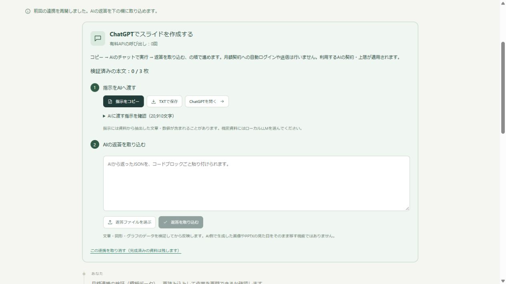
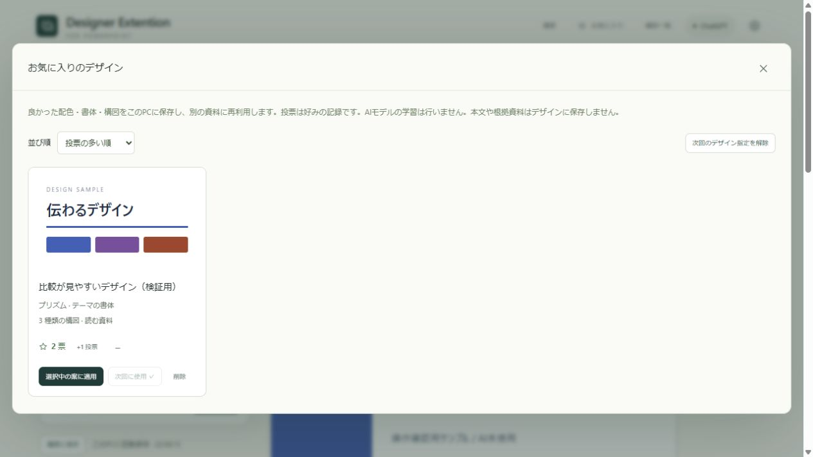
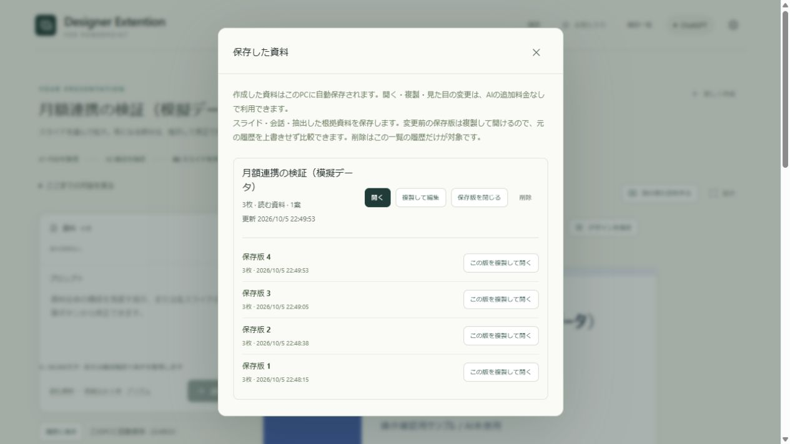

# v0.9.0 検証記録

2026年10月5日。利用者の本番設定・履歴・APIキーを読み込まない検証サーバーで、模擬データのみを使用しました。モデル呼び出しは検証サーバー側で禁止しています。

- 型チェック、109件の自動テスト、Web画面ビルド: 成功。
- ChatGPT形式の指示のコピー、JSON返答から構成確認・本文作成・1枚修正: 成功。未完了JSONを反映せず、返答を保持して理由と修正指示を表示。
- デザイン全体の保存、2票への追加投票、現在の資料への適用、次回の優先設定: 成功。本文・数値を保持。
- 変更前の保存版の表示、過去版の複製: 成功。元の履歴を保持。
- 構成待ち・本文待ち・完成後に同じ画面を再読み込み: 作業を再開。有料APIの呼び出しなし。
- 別の見た目の比較案: AIを呼び出さず作成。
- ローカルMCPの実プロセスを起動し、初期化・4ツールの列挙・指示取得・模擬返答の取り込み・デザイン一覧取得: 成功。返答をアドインの画面へ自動反映。
- PowerPointへの3枚の実書き出し: 編集可能な文字と棒グラフを保持。グラフXMLと埋め込みExcelの値は24・42・58で一致。1600×900のPNG3枚を目視確認し、はみ出し・重なりなし。警告なし。既存資料を閉じる操作なし。

実際の月額アカウントやローカルモデルによる生成品質・速度は未検証です。Claude Desktopへの設定登録は利用者が行う任意の手順として残しています。

再検証にはnative/Serve-SubscriptionVerification.ts、native/Verify-ChatConnector.ts、native/Verify-SubscriptionRendering.tsを使用できます。詳細な出力検証結果はruntime/qa-v090/native-verification.json、runtime/qa-v090/connector-verification.jsonに保存しています。
